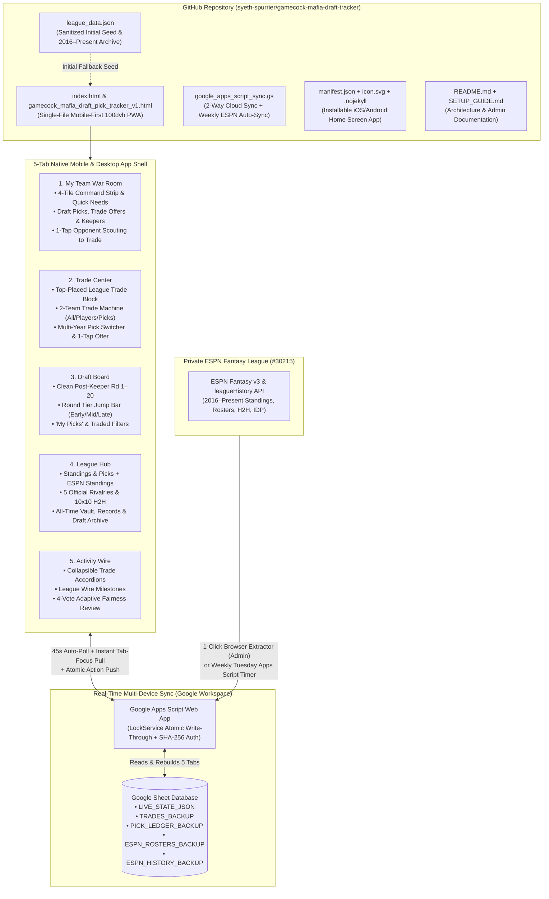
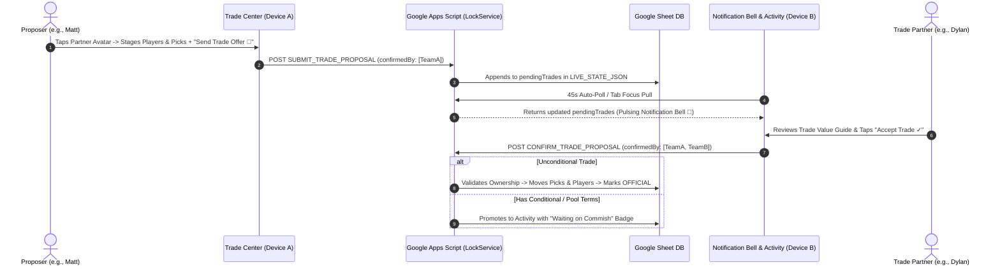

# Gamecock Mafia — Fantasy Football League Hub & Draft Tracker (`v8.3.0`)

Live mobile-first Progressive Web App (PWA) for the **Gamecock Mafia** 10-team keeper league (`2016–Present`), hosted on GitHub Pages with real-time 2-way Google Sheets Cloud Sync and ESPN Fantasy League integration.

- **Live App**: https://syeth-spurrier.github.io/gamecock-mafia-draft-tracker/

---

## 1. GitHub Repository & System Architecture Diagram

---

## 2. Trade Proposal, Partner Validation & Multi-Device Sync Flow

---

## 3. Repository File Map

| File | Role |
| :--- | :--- |
| `index.html` | Primary production entry point served by GitHub Pages (`v8.3.0`). |
| `gamecock_mafia_draft_pick_tracker_v1.html` | Master single-file application source (identical to `index.html`). |
| `google_apps_script_sync.gs` | Google Apps Script backend powering 2-way atomic sync, partner trade validation, and optional weekly Tuesday ESPN auto-sync (`setupWeeklyEspnSyncTrigger`). |
| `league_data.json` | Sanitized baseline seed containing 2016–Present league history, manager alias mapping (`Alex → Geltz`, `Shane → Boss`, `David → Mary`), Slot #10 Alumni lineage (`Scott → Alek → Josh`), and 2026–2028 pick ledgers. |
| `manifest.json` & `icon.svg` | Progressive Web App (PWA) manifest and vector icon for iOS/Android home-screen installation. |
| `SETUP_GUIDE.md` | Commissioner setup, ESPN sync, and security reference. |
