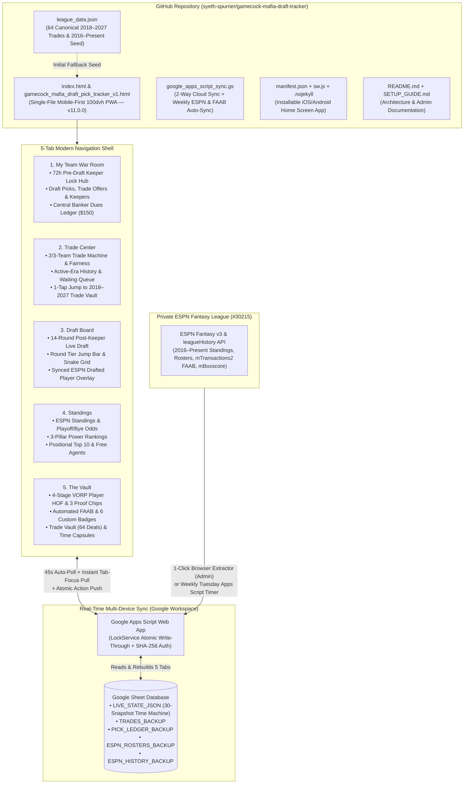
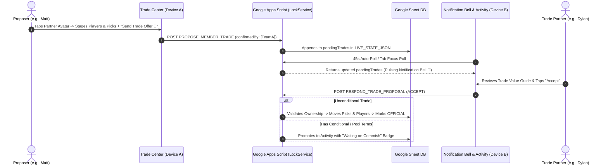

# Gamecock Mafia — Fantasy Football League Hub & Draft Tracker (`v11.0.0`)

Live mobile-first Progressive Web App (PWA) for the **Gamecock Mafia** 10-team keeper league (`2016–Present`), hosted on GitHub Pages with real-time 2-way Google Sheets Cloud Sync and ESPN Fantasy League integration.

- **Live App**: https://syeth-spurrier.github.io/gamecock-mafia-draft-tracker/

---

## 1. GitHub Repository & System Architecture Diagram

---

## 2. Trade Proposal, Partner Validation & Multi-Device Sync Flow

---

## 3. Repository File Map

| File | Role |
| :--- | :--- |
| `index.html` | Primary production entry point served by GitHub Pages (`v11.0.0`). |
| `gamecock_mafia_draft_pick_tracker_v1.html` | Master single-file application source (identical to `index.html`). |
| `google_apps_script_sync.gs` | Google Apps Script backend powering 2-way atomic sync, HOF 4-stage funnel (`maxClassSize: 3`), `mTransactions2` FAAB tracking, and weekly Tuesday ESPN auto-sync (`autoWeeklyEspnSync`). |
| `league_data.json` | Sanitized baseline seed containing all 64 canonical `2018–2027` Draft Sheet trades, locked `2018–2026` draft orders, manager alias mapping, and `2026–2028` pick ledgers (`v11.0.0`). |
| `manifest.json` & `sw.js` | Progressive Web App (PWA) manifest and Network-First Service Worker (`gcm-tracker-v11.0.0`). |
| `SETUP_GUIDE.md` | Commissioner setup, ESPN sync, and security reference. |
